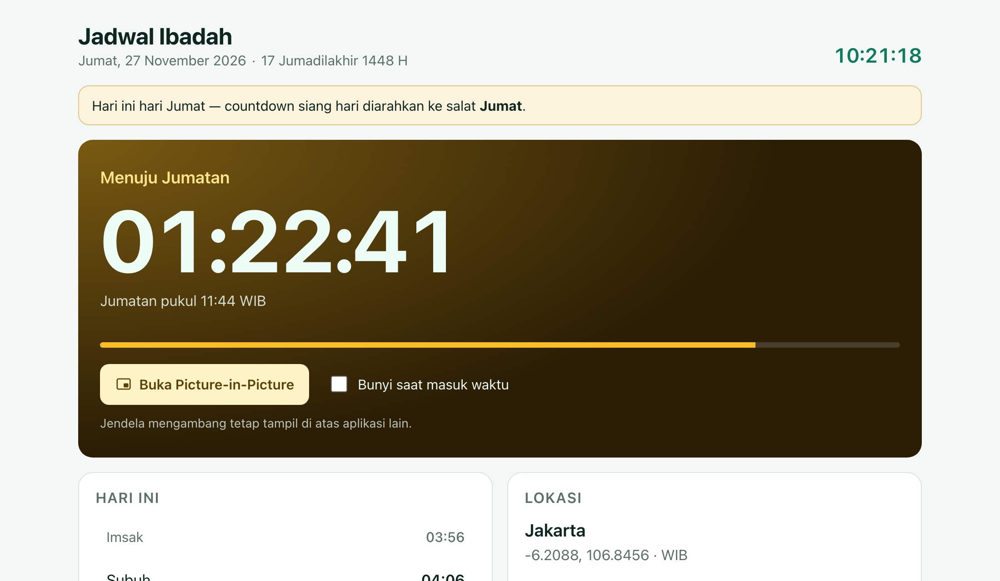
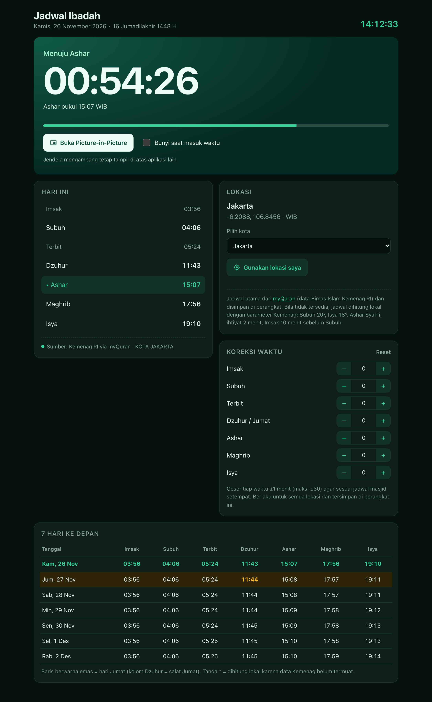
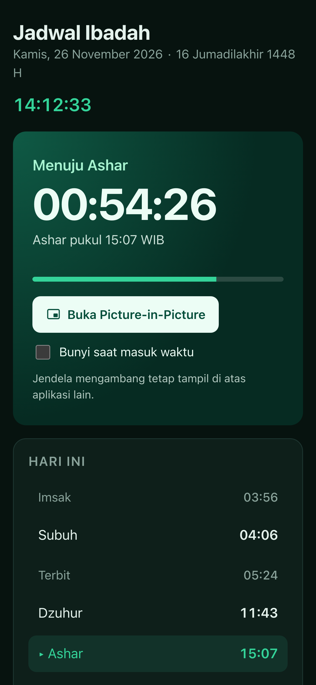
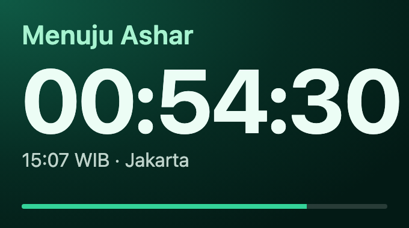
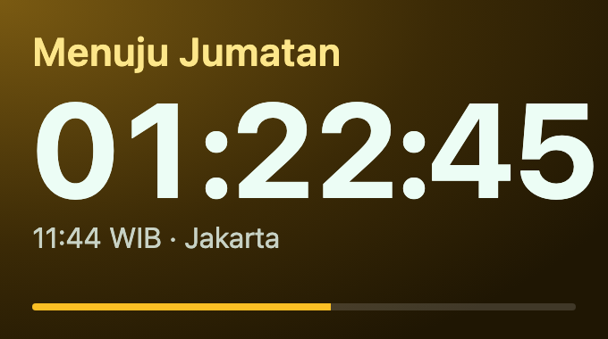
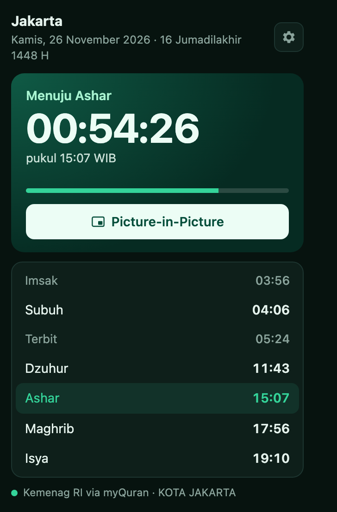
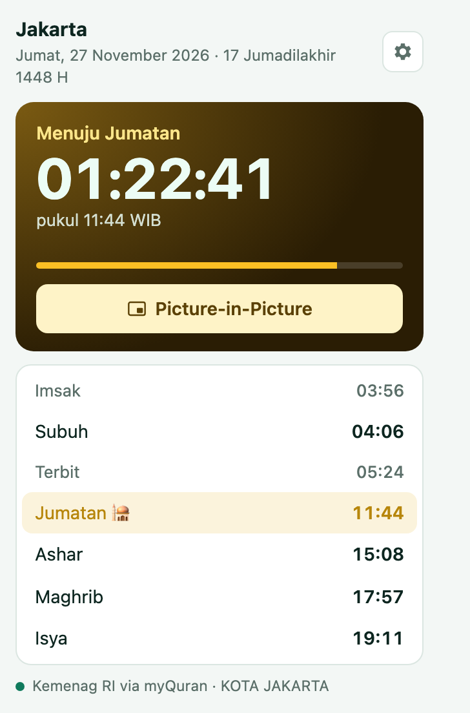
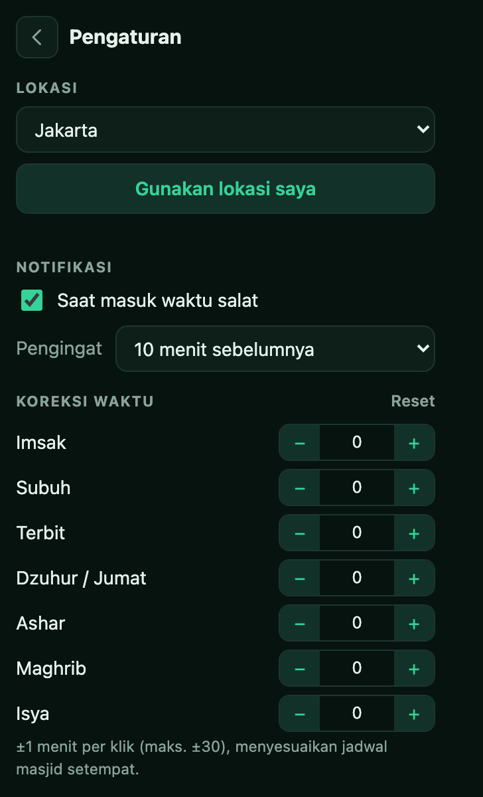

# IbadahQu — Jadwal Ibadah

Aplikasi web jadwal salat (dibuat dengan [Astro](https://astro.build)) dengan **countdown Picture-in-Picture** ke waktu salat terdekat — dan pada **hari Jumat, countdown siang hari diarahkan ke salat Jumat**. Tersedia juga sebagai **Chrome Extension** dengan badge countdown di toolbar dan notifikasi masuk waktu.

<p align="center">
  
</p>

## Daftar isi

- [Screenshot](#screenshot)
- [Fitur](#fitur)
- [Sumber data & metode](#sumber-data--metode)
- [Menjalankan web app](#menjalankan-web-app)
- [Chrome Extension](#chrome-extension)
  - [Build](#1-build)
  - [Pasang manual (Load unpacked)](#2-pasang-manual-load-unpacked)
  - [Upload ke Chrome Web Store](#3-upload-ke-chrome-web-store)
  - [Merilis versi baru](#4-merilis-versi-baru)
- [Struktur proyek](#struktur-proyek)
- [Kompatibilitas Picture-in-Picture](#kompatibilitas-picture-in-picture)

## Screenshot

### Web app

| Desktop (mode gelap) | Mobile |
| --- | --- |
|  |  |

### Jendela Picture-in-Picture

| Hari biasa | Hari Jumat |
| --- | --- |
|  |  |

### Chrome Extension

| Popup | Popup (hari Jumat) | Pengaturan |
| --- | --- | --- |
|  |  |  |

## Fitur

**Web app**

- Countdown real-time ke salat wajib berikutnya + progress bar sejak waktu salat sebelumnya; setelah Isya otomatis menuju Subuh besok.
- **Mode Jumat** — Dzuhur menjadi "Jumatan", tampilan berubah emas, dan muncul banner.
- **Picture-in-Picture** — jendela mengambang yang tetap tampil di atas aplikasi lain.
- Jadwal hari ini (Imsak, Subuh, Terbit, Dzuhur, Ashar, Maghrib, Isya) dan tabel 7 hari ke depan.
- Lokasi: 46 kota se-Indonesia (WIB/WITA/WIT) atau GPS browser; tersimpan di perangkat.
- **Koreksi waktu** ±1 menit per waktu (maks. ±30) untuk menyesuaikan jadwal masjid setempat.
- Tanggal Masehi & Hijriah, bunyi opsional saat masuk waktu, mode terang/gelap otomatis.

**Chrome Extension**

- **Badge countdown** di ikon toolbar (`45m` / `2:15`), berwarna emas saat menuju Jumatan.
- **Notifikasi** saat masuk waktu salat + **pengingat** opsional 5/10/15/30 menit sebelumnya.
- Popup berisi countdown, jadwal hari ini, dan pengaturan (lokasi/GPS, notifikasi, koreksi).
- Picture-in-Picture lewat jendela kecil pembuka.
- Tetap berjalan offline memakai cache jadwal di `chrome.storage`.

## Sumber data & metode

1. **Utama: [API myQuran](https://api.myquran.com)** — data jadwal salat Bimas Islam Kemenag RI per kabupaten/kota. Dipanggil langsung dari browser (CORS terbuka, tanpa API key), diambil per bulan dan di-cache di perangkat.
   ```
   GET https://api.myquran.com/v2/sholat/jadwal/{id_kota}/{yyyy}/{mm}
   ```
2. **Fallback: perhitungan astronomis lokal** (offline) dengan parameter Kemenag — Subuh 20°, Isya 18°, Ashar mazhab Syafi'i, ihtiyat 2 menit, Imsak 10 menit sebelum Subuh. Dipakai bila API gagal/offline atau lokasi GPS jauh (> 30 km) dari kota terdaftar. Selisihnya umumnya ≤ 1 menit dari data Kemenag.
3. **Koreksi manual** diterapkan di atas kedua sumber.

Sumber yang sedang aktif ditampilkan di aplikasi (titik hijau = myQuran, kuning = perhitungan lokal).

## Menjalankan web app

Butuh **Node.js ≥ 22**.

```sh
npm install
npm run dev        # http://localhost:4321
npm run build      # hasil statis di dist/
npm run preview    # pratinjau hasil build
```

Hasil `dist/` berupa file statis sehingga bisa di-hosting di mana saja (Vercel, Netlify, Cloudflare Pages, GitHub Pages, Nginx, dll.). Picture-in-Picture & GPS membutuhkan **HTTPS** (atau `localhost`).

## Chrome Extension

Kode extension ada di folder [`extension/`](extension) dan memakai ulang logika jadwal dari `src/lib/` (dibundel dengan esbuild).

### 1. Build

```sh
npm install
npm run build:ext
```

Hasil:

- `extension/dist/` — folder extension siap dipasang
- `extension/jadwal-ibadah-extension.zip` — arsip untuk diunggah ke Chrome Web Store

### 2. Pasang manual (Load unpacked)

1. Buka `chrome://extensions` di Google Chrome (atau `edge://extensions` di Microsoft Edge).
2. Aktifkan **Developer mode** (toggle di kanan atas).
3. Klik **Load unpacked** lalu pilih folder `extension/dist`.
4. Klik ikon puzzle 🧩 di toolbar → **pin** "Jadwal Ibadah" agar badge countdown selalu terlihat.
5. Klik ikon extension → ⚙️ untuk memilih kota, mengatur notifikasi, dan koreksi waktu.

> **macOS:** bila notifikasi tidak muncul, izinkan di **System Settings → Notifications → Google Chrome**.
>
> Setelah mengubah kode, jalankan `npm run build:ext` lagi lalu klik ikon ↻ pada kartu extension di `chrome://extensions`.

**Cara memakai Picture-in-Picture di extension:** klik tombol *Picture-in-Picture* di popup → muncul jendela kecil → klik **Buka Picture-in-Picture**. Jendela kecil itu otomatis diminimalkan; jangan ditutup karena PiP akan ikut tertutup. (Popup extension tertutup otomatis saat kehilangan fokus, sehingga PiP harus dibuka dari jendela tersendiri.)

### 3. Upload ke Chrome Web Store

1. **Daftar akun developer** di [Chrome Web Store Developer Dashboard](https://chrome.google.com/webstore/devconsole) (biaya registrasi satu kali USD 5) dan lengkapi verifikasi akun.
2. Naikkan `version` di [`extension/static/manifest.json`](extension/static/manifest.json) bila perlu, lalu jalankan `npm run build:ext`.
3. Di dashboard klik **New item** (➕ *Add new item*) → unggah `extension/jadwal-ibadah-extension.zip`.
4. Isi tab **Store listing**:
   - Deskripsi, kategori (mis. *Lifestyle*), bahasa Indonesia.
   - Ikon 128×128 — gunakan `extension/icons/icon128.png`.
   - Screenshot 1280×800 atau 640×400 (minimal 1) — bisa memakai gambar di `docs/screenshots/` yang disesuaikan ukurannya.
5. Isi tab **Privacy** — justifikasi tiap izin:

   | Izin | Justifikasi |
   | --- | --- |
   | `storage` | Menyimpan lokasi, koreksi waktu, pengaturan notifikasi, dan cache jadwal agar bisa dipakai offline. |
   | `alarms` | Memperbarui badge countdown tiap menit dan memicu notifikasi tepat saat masuk waktu salat. |
   | `notifications` | Menampilkan pemberitahuan masuk waktu salat dan pengingat sebelum waktu salat. |
   | `geolocation` | Opsional — menentukan jadwal sesuai lokasi pengguna saat tombol "Gunakan lokasi saya" ditekan. |
   | Host `https://api.myquran.com/*` | Mengambil jadwal salat resmi Kemenag RI dari API myQuran. |

   - **Single purpose:** menampilkan jadwal salat dan countdown ke waktu salat berikutnya.
   - **Remote code:** *No* — semua kode dibundel di dalam paket.
   - **Data usage:** lokasi hanya disimpan di perangkat (`chrome.storage.local`); yang dikirim ke server hanya ID kota myQuran, tidak ada data pribadi yang dikumpulkan atau dijual.
   - **Privacy policy URL:** gunakan [`PRIVACY.md`](PRIVACY.md), mis. `https://github.com/apriliantocecep/ibadahqu-app/blob/main/PRIVACY.md`.
6. Tab **Distribution** — pilih *Public* / *Unlisted* dan negara.
7. Klik **Submit for review**. Proses review biasanya beberapa hari kerja; status bisa dipantau di dashboard.

### 4. Merilis versi baru

1. Naikkan `version` di `extension/static/manifest.json` (mis. `1.0.0` → `1.0.1`). Chrome Web Store menolak versi yang sama atau lebih rendah.
2. `npm run build:ext`
3. Di dashboard pilih item → **Package** → **Upload new package** → unggah zip baru → **Submit for review**.

## Struktur proyek

```
├── src/
│   ├── lib/
│   │   ├── prayTimes.ts     # perhitungan astronomis + util waktu/zona
│   │   ├── schedule.ts      # myQuran + fallback lokal + koreksi + cache
│   │   └── cities.ts        # 46 kota (koordinat, zona waktu, ID myQuran)
│   ├── scripts/
│   │   ├── app.ts           # logika UI web app
│   │   └── pip.ts           # Picture-in-Picture (Document PiP + fallback video)
│   └── pages/index.astro    # halaman utama
├── extension/
│   ├── src/                 # background (badge/alarm/notifikasi), popup, pip-page, core
│   ├── static/              # manifest.json, popup.html, pip.html, CSS
│   ├── icons/               # ikon 16/32/48/128
│   └── build.mjs            # build esbuild → extension/dist + zip
├── docs/screenshots/
└── public/favicon.svg
```

## Kompatibilitas Picture-in-Picture

| Browser | Mode |
| --- | --- |
| Chrome / Edge desktop 116+ | Document Picture-in-Picture (jendela HTML) |
| Safari (macOS/iOS), Chrome Android | Video Picture-in-Picture (countdown digambar ke canvas → video) |
| Firefox | Belum didukung (tombol dinonaktifkan) |

---

Data jadwal © Bimas Islam Kemenag RI via [myQuran](https://api.myquran.com). · [Kebijakan Privasi](PRIVACY.md)
